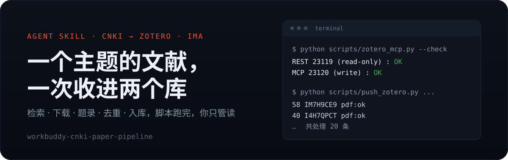
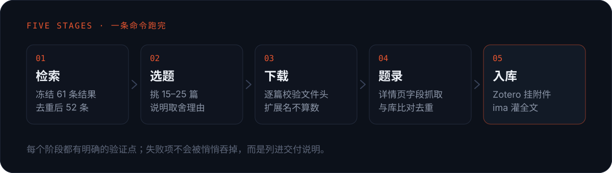

<p align="center">
  
</p>

<p align="center">
  <a href="./LICENSE"></a>
  
  
  
</p>

给一个研究主题，它把知网上的文献从检索做到两个库里都能直接读全文：
**批量下载、逐篇校验、题录抓全、与既有分类去重、Zotero 挂附件、ima 灌全文**，最后给你一份能核对的清单。

## 它解决的不是检索

检索谁都会。真正卡人的是这条链路上的三处断点，每一处都能让人耗掉半天：

- **下载被劫持** —— 点了下载没反应，下载目录里一个文件都没有。认出是下载管理器接管了下载，
  给出具体处置；固定从详情页的 PDF 控件取，而不是结果列表里那个"下载"。
- **题录散落** —— 卷、期、页码只藏在详情页一行题录里，多作者在详情页被粘成一串。
  用固定的提取脚本与正则，作者以结果列表为准。
- **入库不可回滚** —— 传错知识库报 `220030 权限不足`；Zotero 和 ima 两边都没有删除接口。
  把"确认目标库"写进开工前置检查，Zotero 侧再加一道重跑保护。

## 一次真实运行

用"蓝鼎元与潮汕"这个主题跑过一遍，数字都是实际产出：

```text
检索  主题=蓝鼎元 · 学术期刊 · 相关度排序     命中 61 条（分页重复，去重后 52 条）
选题  按研究问题分四组，取核心 20 篇
下载  20 个文件全部通过 %PDF- 文件头校验
题录  20 条卷期页码齐备，摘要与关键词取自详情页
去重  与目标分类既有 10 条比对，发现 5 篇重复 → 保留用户原有记录
入库  Zotero 分类 10 → 25 条；ima 知识库 15 → 35 篇
```

去重那一步值得单独说：5 篇重复里，用户原有条目的卷期字段更全、PDF 文件名是 Zotero 规范格式，
所以**保留原有记录、把新技术条目移出分类**，而不是反过来。判断依据写进了
[`references/zotero-mcp.md`](./references/zotero-mcp.md)。

## 怎么运作

<p align="center">
  
</p>

五个阶段各自有验证点。下载阶段不是看文件扩展名，而是校验 `%PDF-` 文件头——
知网会把 CAJ 或登录错误页存成 `.pdf`，扩展名证明不了任何事。

## 安装

把仓库目录放进宿主的技能目录即可：

```bash
git clone https://github.com/Haoo-7/workbuddy-cnki-paper-pipeline.git \
  ~/.workbuddy/skills/workbuddy-cnki-paper-pipeline
```

如果你的环境走 skills CLI，也可以直接：

```bash
npx skills add Haoo-7/workbuddy-cnki-paper-pipeline
```

或者把仓库地址交给 Agent，让它自己装：

```text
请安装这个 Skill：https://github.com/Haoo-7/workbuddy-cnki-paper-pipeline
```

没有 `pip install`，脚本只用 Python 3.10+ 标准库。

## 依赖

| 组件 | 用途 | 是否必须 |
| --- | --- | --- |
| Python 3.10+ | 跑脚本 | 必须 |
| Zotero 7 + `zotero-integrated-mcp` 插件 | 建条目、挂 PDF、归分类 | 必须 |
| 能驱动登录态浏览器的 CLI（本例用 `bsk`） | 检索与下载 | 必须 |
| ima 知识库连接器 | 第五阶段入库 | 可选，缺省降级为手动上传 |

零配置、零密钥。脚本不读环境变量里的令牌，也不落任何凭据文件；
对象存储的上传凭证由运行时临时签发，只在内存里存活。

## 使用

说清三件事就够：**研究主题（含检索词）/ 目标 Zotero 分类 / 目标 ima 知识库**。
其余信息它自己查，不会反复追问。

也可以单独跑某一步：

```bash
python scripts/zotero_mcp.py --check                       # 环境自检：REST 23119 与 MCP 23120
python scripts/dedup_check.py --collection KEY --items merged.json
python scripts/push_zotero.py  --items merged.json --collection KEY --tags 主题词
python scripts/ima_put.py      --creds creds.json --dir ./pdf
```

`push_zotero.py` 默认带重跑保护：分类里已有同名条目会跳过，重复执行不会灌进第二批副本；
确实要新建副本时加 `--force`。

## 兼容范围

- **已验证**：Windows + Edge + Zotero 7 + Python 3.13，完整跑通一次 20 篇的批量入库。
- **未实测**：macOS / Linux、其它浏览器 CLI。操作序列本身通用，差异集中在
  [`references/cnki-browser.md`](./references/cnki-browser.md) 的命令部分。
- **宿主依赖**：ima 段需要宿主提供 ima MCP 连接器。没有连接器时，前四个阶段照常可用，
  ima 段降级为交付 PDF 让你自己拖进客户端。
- 只覆盖中文知网；英文数据库（Web of Science、JSTOR 等）不在范围内。

## 数据边界

- 不绕过付费墙，不导出 cookie 或访问令牌，不代替用户购买。
- PDF 只从你自己已授权的机构入口获取，也只写进你自己的文库。
- 脚本不联网回传任何本地内容；对象存储写入只指向 ima 签发的目标路径。

## 输出什么

| 文件 | 内容 |
| --- | --- |
| `results_all.json` | 冻结的检索结果，含站内序号与详情页链接，可复现 |
| `merged.json` | 合并题录，字段见 `references/cnki-browser.md` |
| `文献清单.md` | 分组表格 + 检索式 + 命中数 + 入库位置 + 未完成项 |
| `zotero_keys.json` | 新建条目 key 与逐条处理状态 |

## 说明

frontmatter 只用通用字段（`name` / `description` / `license` / `compatibility` / `metadata`），
可以直接被按 agent-plugins 规范校验的宿主加载。若你的宿主要求声明 `agent_created: true`
才能由 Agent 侧编辑或删除技能，在 `SKILL.md` 里加一行即可，不影响任何脚本与流程。

## License

[MIT](./LICENSE)
